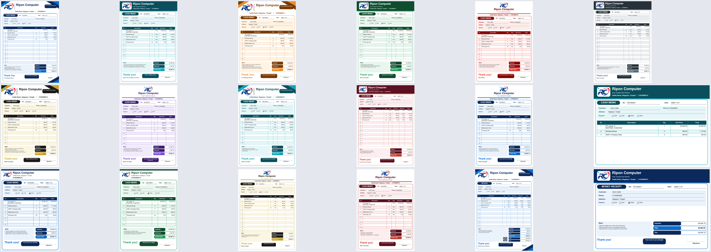
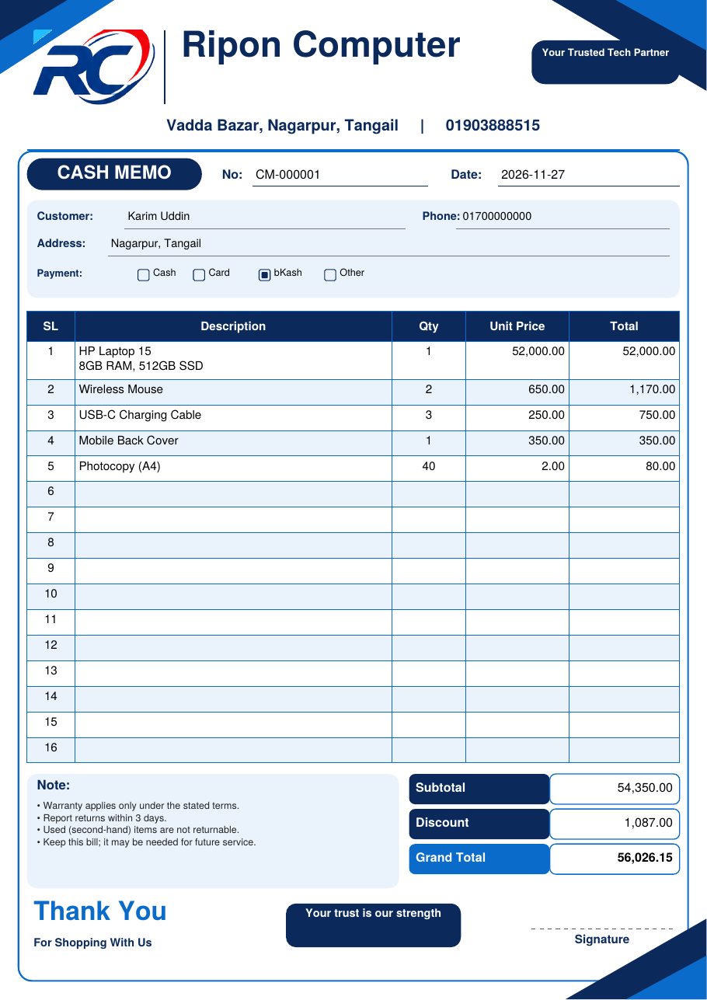

<p align="center"></p>

<h1 align="center">Ripon Cash Memo Studio</h1>
<p align="center"><b>রিপন কম্পিউটার অ্যান্ড ইলেকট্রনিক্স — ক্যাশ মেমো স্টুডিও</b><br>
Professional Business Document Designer · Offline-first · Bengali / English · Windows 10 / 11</p>

A desktop app for Bangladeshi shops to design, create, print and manage **cash memos, invoices and money receipts** — fully offline, with 18 ready-made Bengali templates.
Built with Python, PySide6 and SQLite.

## Features
- **18 ready-made Bengali templates** (computer & electronics, repair, mobile accessories, grocery, pharmacy, hardware, electrical, cloth, stationery, wholesale, retail, photocopy & photo studio, A6 mini slips, gift shop, sweets & bakery, VAT invoice, money receipt). Sizes A4 / A5 / A5-landscape / A6. Shop name, address and phone come from Settings, so one change updates every template.
- **Template Studio** — edit page, elements, table columns (add / rename / resize / reorder), colours; save, duplicate, reuse.
- **Memo editor** — product search, live totals, item and overall discount (% or fixed), VAT / TAX (before or after discount), delivery / service charges, rounding, paid, previous due. All money maths is decimal-safe.
- **Bengali + English** — app language, app font, text size, and separate document language / font (preview, PDF and print always match).
- **Sales history** — search / filter, reprint, duplicate, void with reason and audit trail, permanent delete (backup is taken first).
- **Customers, products (CSV import / export, low-stock alert), reports** (daily / weekly / monthly / yearly, customer, product, VAT & discount, due, payment methods) with CSV / Excel / PDF export.
- **PDF / image export, printing**, QR code and barcode support, dark / light theme.
- **Local SQLite database**, manual and automatic backup, restore.

## Screenshots


> The gallery above shows the 18 template designs rendered with **English labels**. The app prints the same designs with Bengali text.
> App screenshots go in [`docs/screenshots/`](docs/screenshots).

Sample A4 cash memo:

<p align="center"></p>

## Demo files
- [`demo/en/`](demo/en) — all 18 templates as PNG + [`all-18-templates-demo.pdf`](demo/en/all-18-templates-demo.pdf) (English labels).
- Bengali demos: create a memo in the app, open the preview, switch to Bengali and press **ছবি সংরক্ষণ / PDF সংরক্ষণ**.

## Run from source
```bat
py -3 -m venv venv
venv\Scripts\activate
pip install -r requirements.txt
python app.py
```
Tests: `python -m unittest discover -s tests -t .`

## Build the Windows EXE (one file)
- On your PC: double-click `build_exe.bat` → `dist\RiponCashMemoStudio.exe` (Inno Setup 6 installed → `Output\RiponCashMemoStudio_Setup.exe` too).
- Without installing anything: GitHub → **Actions → Build Windows EXE → Run workflow** → download the artifact.
More in [BUILD_WINDOWS.md](BUILD_WINDOWS.md) · usage in [USER_GUIDE.md](USER_GUIDE.md) · status in [PROGRESS.md](PROGRESS.md) · tests in [TEST_REPORT.md](TEST_REPORT.md).

## Project layout
| Folder | Role |
|---|---|
| `core/` | decimal money, calculation engine, BD number format, prefs, paths |
| `db/` | SQLite, migrations, numbering, audit trail, backup / restore |
| `services/` | customers, products, templates, settings, memo creation |
| `templates_lib/` | template model, 18 Bengali presets, English / font preparation |
| `render/` | layout engine, Qt painter backend (Bengali, print), ReportLab backend (headless), QR / barcode |
| `reports/`, `exporters/` | reports, CSV / Excel export |
| `ui/` | PySide6 screens (Fluent look when `PySide6-Fluent-Widgets` is installed, plain Qt otherwise), Bengali / English strings |
| `demo/`, `docs/` | demo output, README images and screenshots |

## Licensing note
`PySide6-Fluent-Widgets` (the modern Fluent look) is **GPLv3 for non-commercial use**; selling the app requires its commercial licence, or build without it (the app falls back to plain Qt). PySide6 is LGPL.

## Author
Ripon Computer · ভাদ্দা বাজার, নাগরপুর, টাঙ্গাইল · 01903888515
